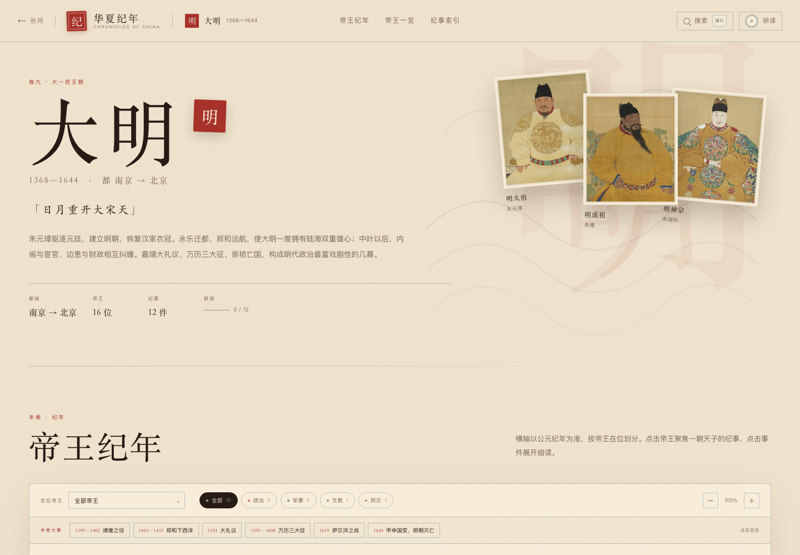
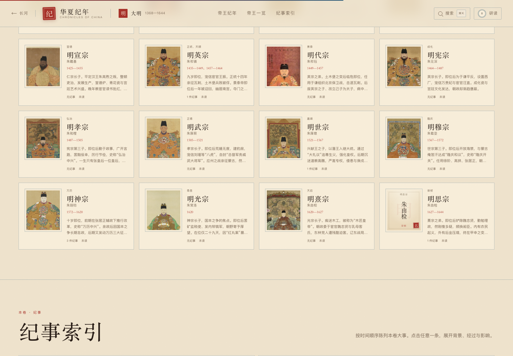
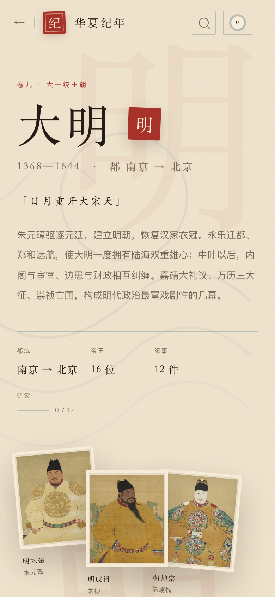

# 华夏纪年 · 中国历史大事记

自秦统一（前 221）至清帝退位（1912）的中国历史纪年网站。默认以朝代为单位铺开一条「长河」，进入某一朝后，则以**公元纪年为横轴、以帝王在位时间分段**，把事件落在具体年份上，点开即可细读背景、经过与影响。

> GitHub 仓库：<https://github.com/BOringuserN4/huaxia-chronicle>

## 打开方式

无需安装依赖、无需构建。

- 直接双击 `index.html` 在浏览器中打开；
- 或在当前目录启动一个本地静态服务器：

```bash
python3 -m http.server 4173
```

然后访问 <http://127.0.0.1:4173/>。

## 预览








## 内容范围

- **十朝**：秦、西汉、东汉、隋、唐、北宋、南宋、元、明、清
- **五段卷外**：新、三国、两晋、南北朝、五代十国
- **112 位帝王 / 134 件大事**
- 重要事件均有独立详述，例如明代的 **靖难之役、大礼议、万历三大征**，以及安史之乱、澶渊之盟、崖山海战、鸦片战争等。

## 功能

- **朝代长河**：按真实时间比例铺开的十五个时代色块，悬停阅读时代小传。
- **帝王纪年轴**：可横向拖动、缩放、按类型筛选；帝王画像或名讳牌位按在位时间落点，点击聚焦一朝纪事。
- **本卷大事**：每卷顶部的快速跳转，一点直达靖难、大礼议、万历三大征等节点。
- **事件抽屉**：摘要、正文、历史影响、关键词、同帝纪事、前后事件翻页。
- **帝王小传**：传世历史画像或名讳牌位、在位年数、年号/纪年、在位纪事。
- **搜索**：`⌘K` / `Ctrl+K` 或 `/`，可搜事件、帝王、朝代、年号。
- **研读进度**：标记已读，进度保存在浏览器 `localStorage`（键名 `huaxia-chronicle-read-v1`），不会上传。
- **响应式**：桌面、平板与手机均可使用；移动端时间轴可横向滑动。

## 目录

```
index.html            页面入口
css/style.css         视觉系统、主题、响应式
assets/portrait-data.js 帝王画像索引与来源
assets/portraits.js   历史画像 / 名讳牌位渲染
assets/portrait-images/ 57 帧帝王历史画像
assets/core.js        数据整理、主题、页头、进度存储
assets/home.js        首页
assets/chronicle.js   朝代时间轴 / 卷外页面
assets/overlays.js    事件抽屉、帝王抽屉、搜索、进度
assets/app.js         Hash 路由与全局交互
data/                 历史数据（按卷拆分）
preview/              README 与展示用截图
LICENSE               代码 MIT 许可证
CONTENT-LICENSE.md    原创文字与第三方画像的授权说明
.nojekyll             GitHub Pages 静态发布标记
```

## 添加或修改一条纪事

在 `data/` 对应文件中找到朝代对象，向 `events` 数组追加：

```js
{
  id: 'ming-example',            // 全站唯一
  year: 1587,
  endYear: 1588,                 // 可选，跨年事件
  era: '万历十五年',              // 事件发生的纪年
  title: '事件标题',
  type: 'politics',              // politics / war / culture / diplomacy / society / disaster
  emperor: 'ming-shenzong',      // 对应 emperors 中的 id
  summary: '一句话摘要',
  detail: '两三百字的经过叙述。',
  significance: '历史影响。',
  tags: ['关键词', '关键词']
}
```

帝王画像在 `assets/portrait-data.js` 中按帝王 `id` 索引：

```js
'ming-taizu': {
  src: 'assets/portrait-images/ming-taizu.jpg',
  source: 'https://commons.wikimedia.org/wiki/File:...',
  license: 'Public domain'
}
```

有索引者显示历史画像；无索引者自动回退为**名讳牌位**——以庙号、个人名、纪年和「名」印组成，不再绘制虚构面孔。新增帝王时，若找到合适的历史画像，裁成 600×709 后放入 `assets/portrait-images/` 并补一条索引即可；不补索引也不会破坏页面。

## 史料与年份说明

- 年份采用通行历史系年；公元前写作「前 X」，公元后写作阿拉伯数字，抽屉日期中统一为「公元 X 年」。
- 帝王在位跨年、并立、复辟处（如唐中宗、睿宗，明英宗、代宗，元文宗、明宗），以主要纪年排列并标注「复」。
- 朝代长河中的色块采用「实际统治中原/全国」的展示区间（如元自 1271 年建号、清自 1644 年入关），卷内页仍保留完整起止年份。
- 事件叙述为学习性梳理，非学术定本；引用史实时建议再核对原典。
- 历史画像来自 Wikimedia Commons，以公有领域宫藏画像、古代版画为主；每幅画像的详情见帝王小传底部的「历史画像来源」链接。无可靠传世画像的帝王不采用现代想象图，以名讳牌位作记。

## 画像来源

- 57 帧帝王画像均来自 [Wikimedia Commons](https://commons.wikimedia.org/)，以公有领域宫藏画像、古代版画为主。
- 每幅画像在帝王小传底部附有「历史画像来源」链接，可直接查看原图页与授权信息。
- 对没有可靠传世画像的帝王，不再生成虚构面孔，改用名讳牌位：庙号、个人名、纪年与「名」印。牌位与画像使用同一尺寸，时间轴、帝王一览和首页卡片中可以直接混排。

## 部署

项目是纯静态站点，不需要构建。

- **GitHub Pages**：仓库 `Settings → Pages → Deploy from a branch`，选择 `main` 分支与 `/ (root)` 目录即可；仓库已包含 `.nojekyll`。
- **其他静态托管**：直接把仓库根目录作为站点根目录发布，`index.html` 为入口。
- 所有图片、字体与脚本均在仓库内，不依赖外部 CDN。

## 许可证

- **代码**：MIT，见 [LICENSE](LICENSE)。
- **原创文字与版式**：© 2026 yuexinzuo，保留权利；非商业学习引用请注明来源。
- **历史画像**：不适用 MIT，授权以 Wikimedia Commons 原图页为准；详见 [CONTENT-LICENSE.md](CONTENT-LICENSE.md) 与 `assets/portrait-data.js`。

## 技术

- 纯静态 HTML / CSS / JavaScript，无框架、无外部字体或图片依赖，可离线打开。
- 视觉主题按朝代切换（秦黑、汉赤、唐金、宋青、元蓝、明朱、清黄等），纹样与纸色同步变化。
- 帝王像为本地历史画像；无画像者使用纯 CSS/HTML 名讳牌位，不依赖网络图片。
